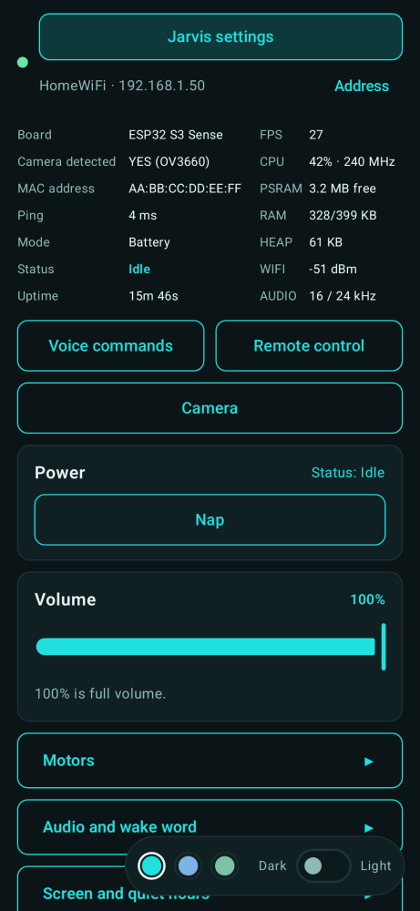
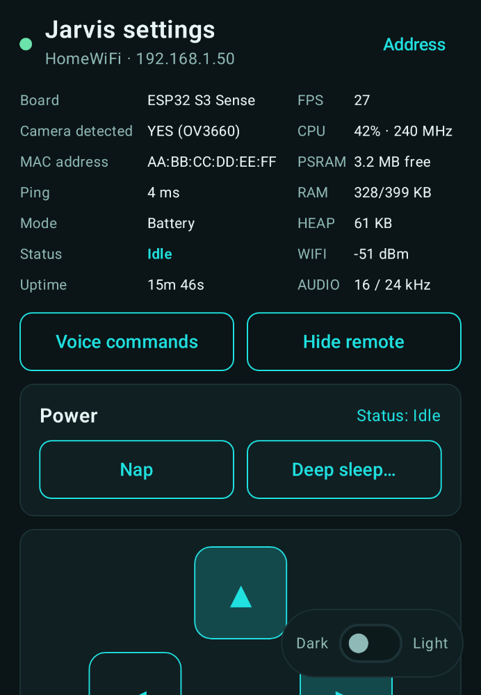
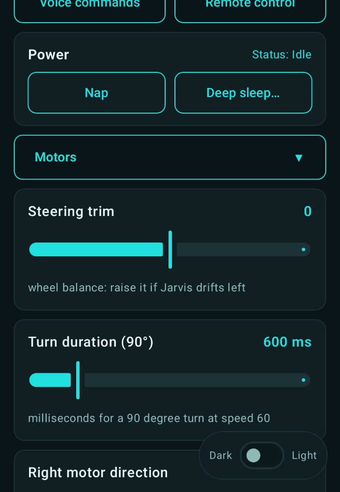
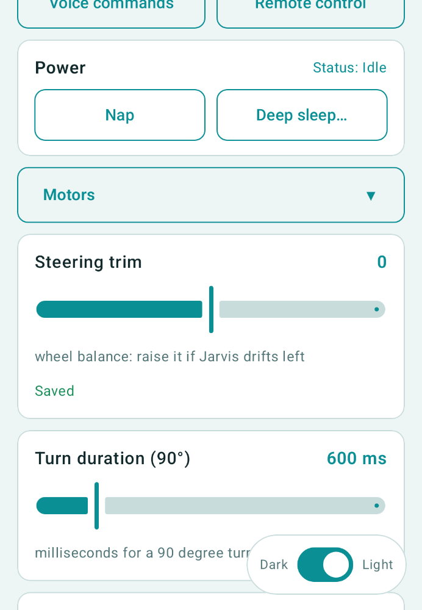
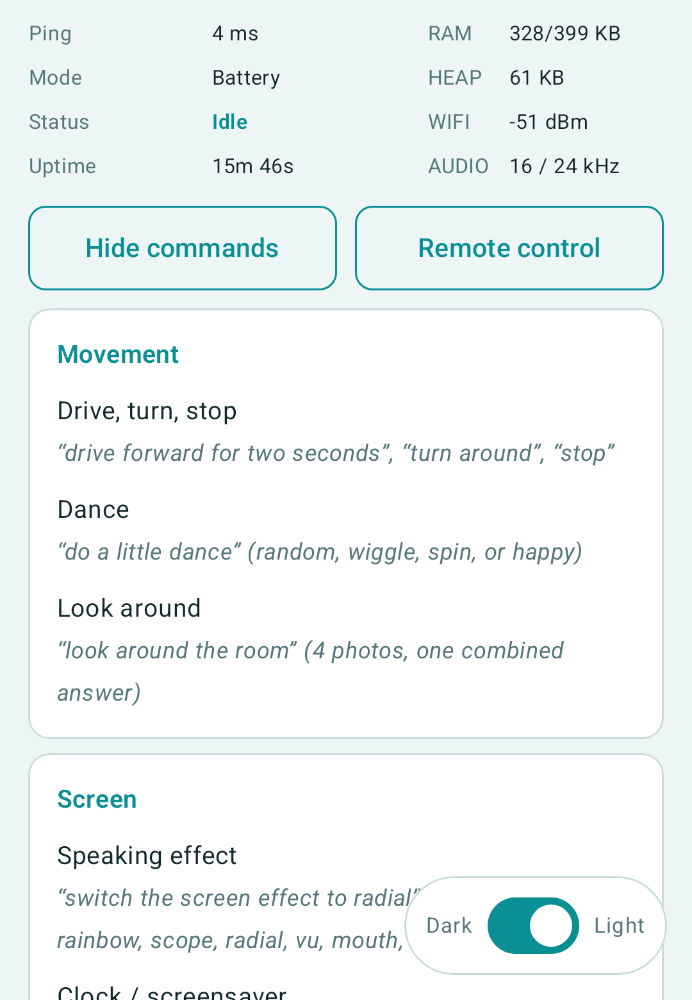
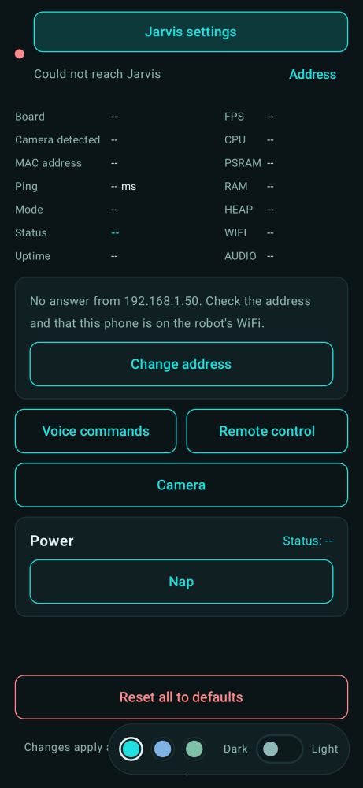
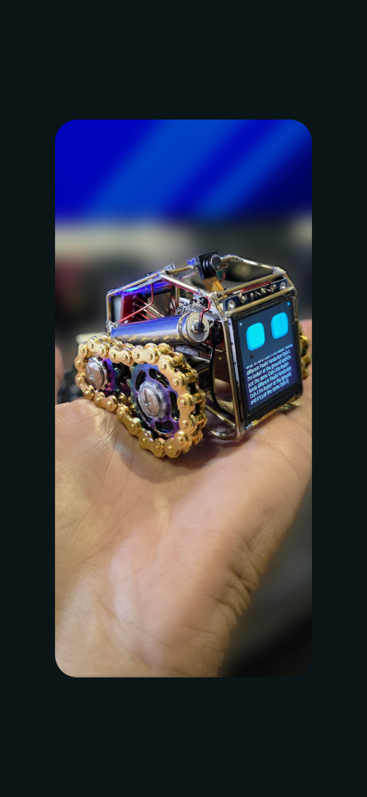
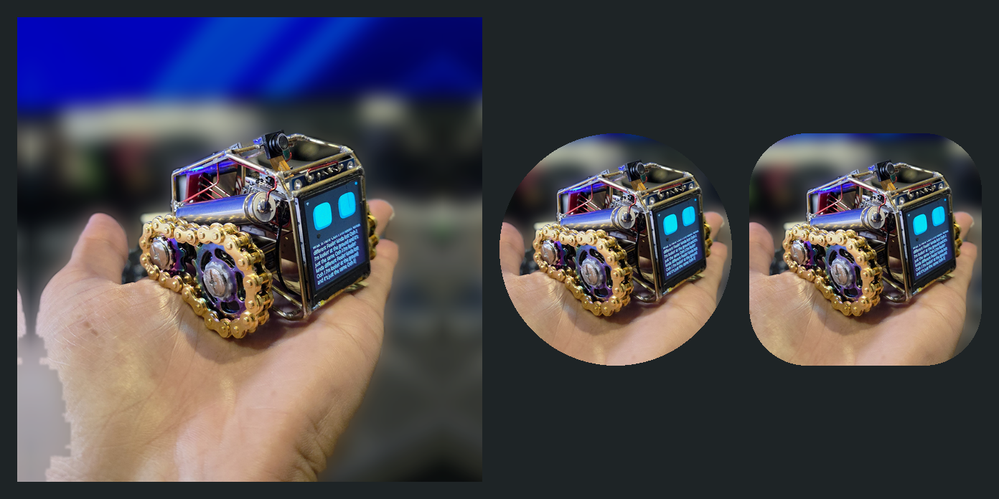
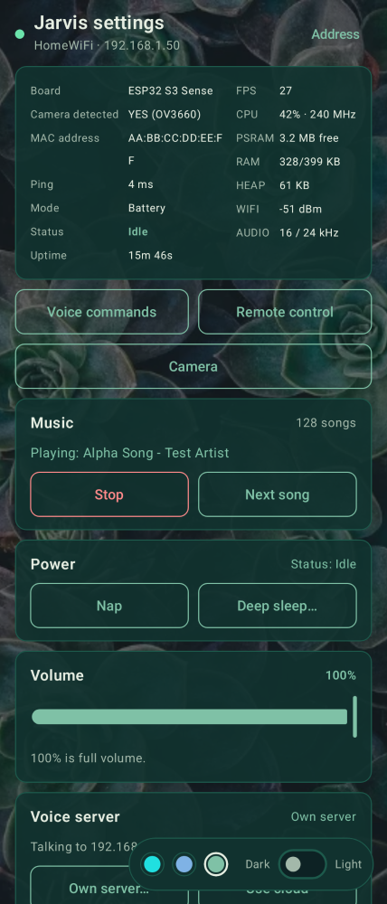
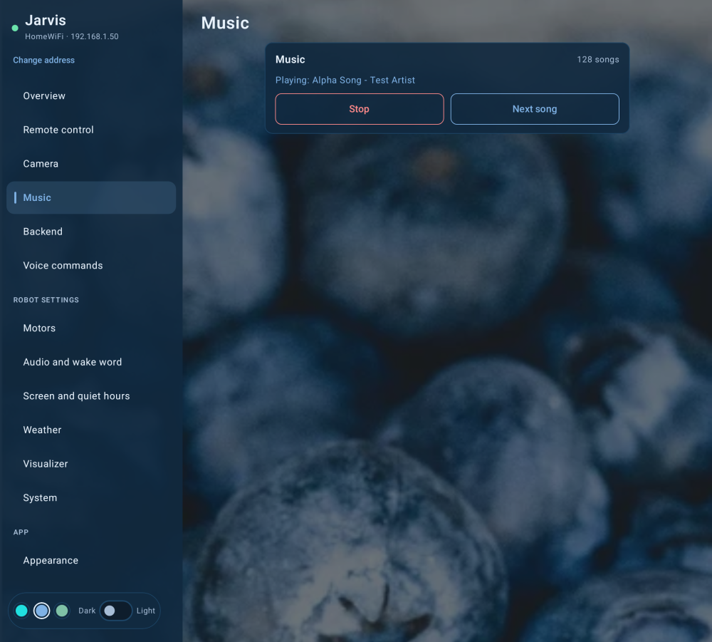

# Jarvis - Android app for the robot

A native Android app (Kotlin, Jetpack Compose) with the same screens as the robot's
[landing page](https://github.com/txrx007-hub/jarvis-landing-page): live device info, remote control,
power (nap, deep sleep) and every setting. It talks to the robot's HTTP API on your home WiFi
([API description](https://github.com/txrx007-hub/jarvis-landing-page/blob/main/docs/API.md)), so it works
with the firmware as it is. The robot is built on the
[xiaozhi-esp32](https://github.com/78/xiaozhi-esp32) firmware
([Jarvis branch](https://github.com/txrx007-hub/xiaozhi-esp32/tree/wall-e)).

| Main (dark) | Remote control | Settings (dark) | Settings (light) |
|---|---|---|---|
|  |  |  |  |

| Voice commands | Robot not reachable | Splash (4 s) | App icon |
|---|---|---|---|
|  |  |  |  |

Music card (Stop / Next song) on the cover screen and in the unfolded two-pane layout:

| Folded | Unfolded |
|---|---|
|  |  |

(Screenshots are drawn on a PC from made-up sample data; the network name, address and MAC shown are
fake. The photo on the splash and icon is the author's robot.)

## What it has

| Section | |
|---|---|
| Info table | Board, camera detected (+ sensor), MAC, ping, mode (console / battery), status, uptime, FPS, CPU, PSRAM, RAM, heap, WiFi signal, audio rate |
| Remote control | Hold-to-drive pad at full speed; the app re-sends every 150 ms and the robot stops 500 ms after the last command, so a dropped connection stops it. Two arrows together turn in an arc. The screen stays on while the pad is open and leaving the app stops the robot. |
| Volume | Slider 0-100 (100 is full volume); says so when night mode (quiet hours) holds it lower |
| Voice server | Shows whether the robot uses the xiaozhi.me cloud or your own server; switch either way (the robot restarts), open the own server's control panel in the browser and see its PIN |
| Power | Nap / Wake up, Deep sleep for any hours + minutes with shortcuts and a confirmation |
| Settings | Built from the robot's own settings list (so new firmware settings appear without an app update); Motors, Audio and wake word, Screen and quiet hours are collapsible |
| Voice commands | The list of what you can say to the robot |
| Theme | Dark / light slider, follows the phone's setting at first |

Extras a web page cannot do: it remembers the robot's address, can **scan your WiFi for the robot**, keeps
its traffic on WiFi (Android otherwise may use mobile data when the robot's network has no internet) and
only talks to the robot while the app is on screen.

## Install

Download the APK from the **[latest release](../../releases/latest)**, open it on the phone and allow
"install unknown apps" once. The phone must be on the same WiFi as the robot; enter the robot's IP address
(or tap *Scan network*). The APK is signed with a debug key (this is a hobby project, not on the Play Store).
The app uses plain HTTP, like the page in a browser, and asks only for network permissions.

## Build

Needs JDK 17 and the Android SDK (platform 35, build-tools 35). Set `ANDROID_HOME` to the SDK folder (or put
`sdk.dir=...` in `local.properties`, which is not committed).

```
./gradlew assembleDebug          # -> app/build/outputs/apk/debug/app-debug.apk   (Windows: .\gradlew.bat or .\build.ps1)
./gradlew test                   # 32 unit and screenshot tests
./gradlew recordPaparazziDebug   # redraws the screenshots (app/src/test/snapshots/images)
```

The tests check parsing of the robot's replies, the drive maths and every HTTP call against a fake robot
server, and draw the screens on the PC with [Paparazzi](https://github.com/cashapp/paparazzi), no phone
needed. To try the app without a robot, run the fake robot from the
[landing page repository](https://github.com/txrx007-hub/jarvis-landing-page) (`python mock/mock_robot.py`)
and enter your PC's address in the app.

`tools/make_splash.py` shows how the splash image was made (cut-out of the subject, blurred background, zoom);
it needs `pip install rembg[cpu] pillow scipy`.

## Notes

- The robot's WiFi can be weak, so timeouts are short and the screen shows "Could not reach Jarvis" after
  three failed polls instead of hanging.
- Deep sleep switches the robot's WiFi off; the app cannot wake it (BOOT button or its timer does).
- There is no login on the robot's API. Use it on a network you trust.

## License

MIT, see [LICENSE](LICENSE).
